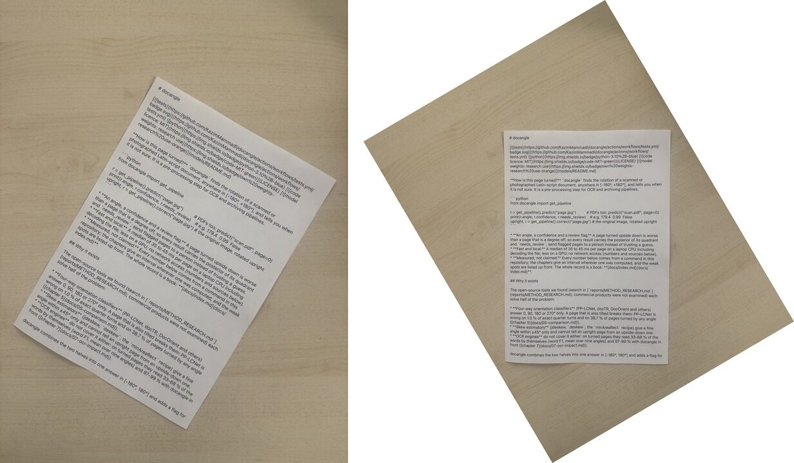
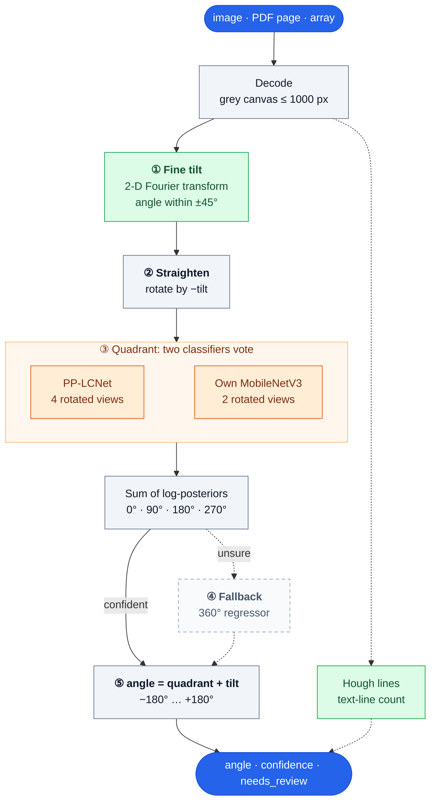

# docangle

[](https://github.com/KazimMammadli/docangle/actions/workflows/tests.yml)  [](LICENSE) [](models/README.md)

**How is this page turned?** `docangle` finds the rotation of a scanned or photographed Latin-script document, anywhere in [-180°, +180°], and tells you when it is not sure. It is a pre-processing step for OCR and archiving pipelines.



*One phone photo of a printed page, not a benchmark: `python -m docangle photo.jpg -o upright.jpg` gave angle −30.4°, confidence 0.999, `needs_review` false ([`reports/readme_example.txt`](reports/readme_example.txt)). The white corners belong to the output: the turned image is not cropped.*

```python
from docangle import get_pipeline

r = get_pipeline().predict("page.jpg")          # PDFs too: predict("scan.pdf", page=0)
print(r.angle, r.confidence, r.needs_review)    # e.g. 179.4  0.99  False
upright, r = get_pipeline().correct("page.jpg") # the original image, rotated upright
```

* **An angle, a confidence and a review flag.** A page turned upside down is worse than a page that is a degree off, so every result carries the posterior of its quadrant and `needs_review`; send flagged pages to a person instead of trusting a guess.
* **Fast and local.** A median of 35 to 45 ms per page on a laptop CPU including decoding the file, less on a GPU; no network access (numbers and sources below).
* **Measured, not claimed.** Every number below comes from a command in this repository; the chapters give an interval wherever one was computed, and the weak spots are listed up front. The whole record is a book: **[docs/index.md](docs/index.md)**.

## Why it exists

The open-source tools we found (search in [`reports/METHOD_RESEARCH.md`](reports/METHOD_RESEARCH.md); commercial products were not examined) each solve half of the problem:

* **Four-way orientation classifiers** (PP-LCNet, docTR, DocOrient and others) answer 0, 90, 180 or 270° only. A page that is also tilted breaks them: PP-LCNet is wrong on 1.0 % of exact quarter turns and on 38.7 % of pages turned by any angle ([chapter 5](docs/05-comparison.md)).
* **Skew estimators** (jdeskew, `deskew`, the `minAreaRect` recipe) give a fine angle within ±45° only and cannot tell an upright page from an upside-down one.
* **OCR engines** do not cover it either: on turned pages they read 33-68 % of the words by themselves (word F1, mean over nine angles) and 97-99 % with docangle in front ([chapter 7](docs/07-ocr-impact.md)).

docangle combines the two halves into one answer in [-180°, 180°] and adds a flag for the pages it is unsure about, so that a person checks those instead of every page.

## At a glance

| | |
|---|---|
| wrong quadrant, simulated pages turned by any angle (3600 cases) | **0.58 %** on the four primary pools; none of them accepted by the review rule on pages whose source is itself upright. The three external pools (2700 cases): 1.93 %, 6 accepted |
| exact quarter turns of clean pages (700 cases, 7 pools) | **0 wrong** |
| real phone camera (SmartDoc, 30 English documents) | page cut out: Fourier tilt within 1° 76.7 % against Hough 64.8 % (420 frames); whole frames the other way round (46.4 % against 56.4 %, same 420 frames); with the opt-in page finder, whole frames within 1° 42.9 % to 73.1 % (926 frames) |
| effect on OCR (12 Azerbaijani pages, 3 engines) | OCR alone 33-68 % word F1 (mean over nine angles), **with docangle 97-99 %** (the level of a perfectly straightened page) |
| speed | median 35-45 ms per page for a JPEG file on a CPU (`reports/latency_files_v4_4.txt`, repeat run in `_repeat.txt`); GPU: 16.8 ms against 38.6 ms CPU for in-memory pages in a separate environment (`reports/gpu_ab.txt`); a 100-page synthetic JPEG-scan PDF in 2.7 s with the opt-in JPEG fast path (6.9 s without it; 6.6 s for a Flate-compressed scan PDF, which the fast path does not take) |
| review | 0.7 % of simulated clean scans of the primary pools (1.1 % over scan and both photo levels), 3.8 % of the mixed external pages, 7.6 % of simulated receipt photographs (mean of the levels scan 6.7 %, photo_easy 5.3 %, photo_hard 10.7 %) go to review |

**Weak spots, stated up front.** There is no labelled set of real phone photos of the intended documents yet; photographic conditions are simulated and the only real camera footage is SmartDoc (30 English documents; the CORD receipts are turned and degraded by simulation). Receipts photographed by phone flip in 2.7 % of cases (most are reviewed). [Chapter 10](docs/10-limitations.md) has the full list.

## Where it works, and where it was not tested

| | |
|---|---|
| **measured** | printed Latin-script pages: English-language scans and forms (Tobacco3482, RVL-CDIP invoices, FUNSD), report and manual pages (DocLayNet), receipts photographed by phone (CORD), born-digital Azerbaijani pages, and real phone video of 30 English documents (SmartDoc); as images, simulated photographs and PDF pages |
| **weaker** | narrow receipts, pages that are mostly a picture, and photos where the page is small in the frame (use `doc_crop=True`); see the weak spots above |
| **not tested: do not assume it works** | Arabic-script and other right-to-left text, Cyrillic, CJK, Indic scripts, handwriting, curved or strongly keystoned pages. A page with fewer than 8 detected text lines is always sent to review (`TOO_FEW_LINES`), whatever its script |

If your documents fall in the last row, measure first: [chapter 9.4](docs/09-usage.md) shows how to check docangle on a sample of your own pages.

## Compared with other open-source tools

Same input images, same machine, same task, 95 % intervals that count pages ([chapter 5](docs/05-comparison.md); `bench/compare_open_models.py`). Wrong-quadrant rate in %, lower is better; each tool gets the page exactly as an application would hold it, and tools are also tried behind docangle's own straightening (their best case) in the chapter. Times are for pages already in memory, on a laptop CPU.

<!-- generated:summary -->
| tool | exact quarter turns | hand-held photo (quadrant ± 25°) | any angle | real phone frames, page cut out | real phone frames, whole frame | median ms per page, any angle |
|---|---|---|---|---|---|---|
| docangle | 0.0 % | 0.5 % | 0.8 % | 1.4 % | 7.6 % | 28 |
| PP-LCNet | 1.0 % | 23.2 % | 38.7 % | 18.3 % | 27.9 % | 4 |
| docTR | 4.0 % | 6.0 % | 10.1 % | 5.2 % | 14.8 % | 15 |
| DocOrient | 19.4 % | 78.6 % | 82.4 % | 30.2 % | 52.4 % | 62 |
| EfficientNetV2 | 9.3 % | 17.6 % | 25.4 % | 6.4 % | 18.8 % | 121 |
| Tesseract OSD | 35.3 % | 64.2 % | 70.3 % | 95.5 % | 97.4 % | 472 |
<!-- /generated -->

On every setting docangle makes the fewest wrong-quadrant errors. The one clean-page setting where another tool comes close is exact quarter turns, where PP-LCNet (one of docangle's own voters) is within a point and 6 to 7 times faster. With tilt the others lose 6 to 63 points between exact quarter turns and any angle; behind docangle's own tilt step the best of them, docTR, still makes seven times its errors. docangle's review flag sends 2.7 % of the any-angle pages to a person and leaves 0.1 % wrong among the rest; the scores of the other tools separate their errors far less well (at the same share held back docTR stays wrong on 2.3 to 8.9 % of the rest), and none of them gives a fine angle. The chapter has the intervals, the per-pool tables, the tools behind docangle's straightening, the real-camera frames, and eleven threats to validity (some of which favour docangle).

## Install

```bash
git clone https://github.com/KazimMammadli/docangle && cd docangle
pip install -e .            # numpy, opencv-python-headless, onnxruntime
pip install -e ".[pdf]"     # + pypdfium2 for PDF input
```

Not on PyPI: the models are part of the repository, so install from a clone.

Tests and checks (the same as continuous integration):

```bash
pip install -e ".[dev,pdf]"
pytest -q && ruff check . && python -m tools.gen_config_doc --check && python -m tools.check_links
```

Python 3.10 or newer (continuous integration runs 3.10 and 3.12; the accuracy, comparison and CPU speed measurements used 3.14; the OCR study and the GPU measurements ran in separate environments (`reports/environments_ocr_gpu.txt`) with Python 3.11.16, onnxruntime-gpu 1.19.2, PaddleOCR 3.7, EasyOCR 1.7.2 and Tesseract 5.5.3). Models are read from `models/` (see [`models/README.md`](models/README.md) for what is included and under which terms); `DOCANGLE_MODELS_DIR` points elsewhere. A GPU is optional (`PipelineConfig(ort_provider="cuda")`).

## Command line

```bash
python -m docangle page.jpg                       # file, angle, confidence, quality, reasons
python -m docangle scans/ --json                  # a folder, JSON lines
python -m docangle page.jpg -o upright.jpg        # also write the straightened image
python -m docangle job.pdf --page all --consensus # pages of one scan job decide together
python -m tools.ocr_pipeline scan.pdf --out out/  # PDF to angle to upright page to OCR text, on the GPU
```

## How it works



Green: signal processing, no learned model. Orange: neural networks. Dashed: side paths (the rare fallback; the line count only feeds the review flag). `needs_review` is set when the confidence is below 0.90, the page has fewer than 8 text lines, or it is blank or unreadable.

Chapter 2 gives the formulas and the reasons, chapter 11 every idea that was tried and rejected.

## Documentation (the book)

| | |
|---|---|
| [1 Introduction](docs/01-introduction.md) · [2 Design](docs/02-design.md) · [3 Models and data](docs/03-models-and-data.md) | what it is and how it is built |
| [4 Evaluation protocol](docs/04-evaluation-protocol.md) · [5 Comparison](docs/05-comparison.md) · [6 Results](docs/06-results.md) · [7 Effect on OCR](docs/07-ocr-impact.md) · [8 Speed](docs/08-performance.md) | how it was measured and what came out |
| [9 Using it](docs/09-usage.md) · [10 Limitations](docs/10-limitations.md) · [11 Decision log](docs/11-decisions.md) · [12 Reproducing](docs/12-reproduce.md) | using it, trusting it, checking it |
| [Appendix A: configuration](docs/appendix-a-config.md) · [Appendix B: references](docs/appendix-b-glossary-references.md) | reference |

The day-by-day lab notebook behind the book is [`reports/FINAL_REPORT.md`](reports/FINAL_REPORT.md); the survey of other methods is [`reports/METHOD_RESEARCH.md`](reports/METHOD_RESEARCH.md).

## Layout

```
docangle/   the library: pipeline, Fourier tilt, classifier and regressor wrappers, consensus, document finder, PDF, CLI
models/     ONNX models and manifest (checksums, provenance, terms)
bench/      photo simulator, metrics with page-level intervals, runner, accuracy guard, the open-source comparison, OCR experiments (index: bench/README.md)
tools/      label_server (browser labelling), first_look (label-free look at real photos), ocr_pipeline (angle + OCR in one command)
src/        data preparation, label audit, training and export of the own classifier
data/       download script for the public pools, a pool list, generated page backgrounds (see data/README.md)
tests/      unit tests (those that need benchmark pages skip themselves when data/ is absent)
docs/       the book
reports/    stored results with commit, configuration and versions (index: reports/README.md)
```

## Contributing, citing, licence

[CONTRIBUTING.md](CONTRIBUTING.md): a change to the default behaviour needs a paired measurement, and the guide says how to make one. Cite with [CITATION.cff](CITATION.cff). The code is MIT-licensed ([LICENSE](LICENSE)). The bundled PP-LCNet model is Apache-2.0; **the project's own model weights were trained on research-only data and are for research and evaluation use** ([models/README.md](models/README.md) says why and how to train your own); third-party material is listed in [NOTICE.md](NOTICE.md); version history in [CHANGELOG.md](CHANGELOG.md).
